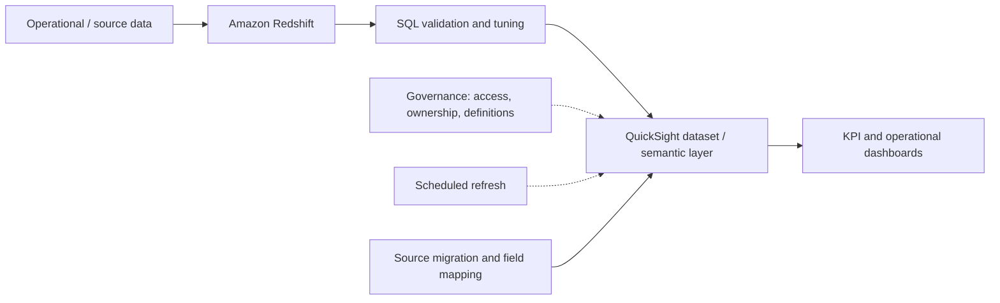

# BI Dashboard with Amazon QuickSight and Amazon Redshift

> Portfolio case study documenting a BI workflow: SQL validation, Redshift connectivity, a QuickSight semantic layer, KPI reporting, governance, scheduled refresh, and data-source migration.

## Project overview

This portfolio documents a Business Intelligence workflow built around **Amazon Redshift** as the analytical data warehouse and **Amazon QuickSight** as the BI/reporting layer.

The source project PDF describes these activities:
- Testing and debugging SQL queries in Redshift.
- Connecting QuickSight to Redshift tables using the intended cluster.
- Creating a semantic model/dataset in QuickSight with custom SQL.
- Creating KPI dashboards.
- Managing data governance.
- Scheduling refreshes.
- Migrating a data source and remapping fields.
- Presenting example dashboards for received inventory of Hazmat items, received inventory of ATAC items, and employee compliance hours.

**Evidence boundary:** this repository is a portfolio reconstruction from screenshots and captions. The PDF does not provide the original SQL, full schema, exact KPI definitions, refresh cadence, IAM policy, or production connection details. SQL files here are illustrative templates, not the original production code. Replace sample names and logic with verified project details before claiming them as implemented.

## Architecture



## Repository structure

```text
.
├── README.md
├── docs/
│   ├── screenshot-explanations.md
│   └── architecture.mmd
├── sql/
│   ├── 01_received_inventory_template.sql
│   ├── 02_data_quality_checks.sql
│   └── 03_performance_review.sql
├── .gitignore
└── LICENSE
```

## Workstream details

### 1. SQL validation and tuning
Validate the expected grain, joins, filters, null handling, duplicate behavior, date logic, and aggregate totals before exposing a query to a dashboard. Review the query plan and scan volume where available. Do not claim a query is optimized unless the before/after behavior has been measured.

### 2. Redshift to QuickSight connectivity
Configure the QuickSight data source to use the intended Redshift cluster/database and a least-privilege database identity. Verify network reachability, authentication, schema/table permissions, and a small test query. Never commit credentials, hostnames, account IDs, or production identifiers.

### 3. Semantic model / dataset
A custom SQL dataset can provide a stable reporting layer for fields, joins, filters, and calculated measures. Document each field's business meaning and expected grain. Keep metric definitions consistent across dashboards.

### 4. KPI dashboard
The screenshots show a Hazmat received-inventory dashboard with a table and multiple trend charts, plus an ATAC inventory dashboard with summary values, a trend visualization, and tables. Exact KPI names and calculation rules should be transcribed from an authorized source before this portfolio is treated as a metric specification.

### 5. Governance
Document dataset owners, authorized roles, data classification, row/column restrictions where required, refresh expectations, and definitions. The screenshot indicates governance-related configuration but does not expose enough detail to identify the exact policy used.

### 6. Refresh schedule
Set a refresh cadence based on source update frequency and business needs. Validate the last successful refresh and monitor failures. The source screenshot shows a schedule setup screen; it does not specify the exact cadence.

### 7. Data-source migration
The source includes a migration flow and a field-mapping screen. After changing a source, verify field mappings, data types, calculated fields, filters, joins, visuals, and totals. Test the dashboard before publishing the migrated version.

### 8. Example reports
- **Supply Chain Received Inventory for Hazmat Items:** detailed inventory table and multiple trend charts.
- **Supply Chain Received Inventory for ATAC Items:** summary figures, trend chart, and detail tables.
- **Employee compliance hours:** compliance matrix with conditional colors and a separate PPR hours monitoring dashboard.

The screenshots are examples of reporting outputs, not enough evidence to infer the exact formulas, thresholds, or operational rules.

## SQL templates

The SQL in `sql/` uses placeholder table and column names. Adapt it only after confirming the real schema and business definitions.

## Suggested validation checklist

- [ ] Confirm source table names, column types, and row grain.
- [ ] Compare query totals with an agreed source-of-truth report.
- [ ] Test nulls, duplicates, late-arriving records, and date boundaries.
- [ ] Check joins for unintended row multiplication.
- [ ] Record query runtime and scan metrics before/after tuning.
- [ ] Confirm QuickSight field mappings after source changes.
- [ ] Validate refresh status and dashboard totals after refresh.
- [ ] Review access permissions and remove sensitive information from screenshots.
- [ ] Publish only approved screenshots and sanitized sample data.

## Portfolio disclaimer

This repository is documentation and example SQL based on the supplied project presentation. It is not an export of the original QuickSight analysis or Redshift production environment. No credentials, real records, or proprietary data should be added.

## Skills demonstrated / documented

- Amazon Redshift
- SQL debugging and query review
- Amazon QuickSight datasets and dashboards
- KPI and operational reporting
- Data governance concepts
- Scheduled refresh workflows
- Data-source migration and field mapping
- Dashboard validation and documentation
